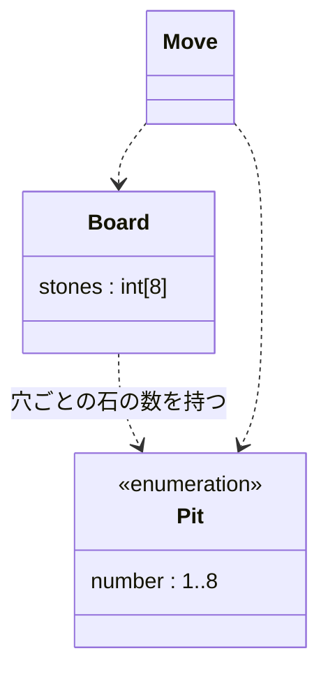

# ドメインモデル

用語（ユビキタス言語）は README.md の「用語」に従う。

STEP 01 時点のモデル。

- 盤面（Board）は穴（Pit）ごとの石（stone）の数を持つ。石は区別しないので、数だけを扱う。
- 穴は輪の形に並んだ8つで、8の隣は1。穴はアイデンティティ（番号）だけを持ち、石の数は持たない。どの盤面にも属さない値なので、ある盤面から取った穴は、別の盤面でも同じ穴として通用する。
- 手（Move）は、穴を1つ選んで、その穴の石を時計回りに蒔くこと。主要な概念なので独立して書く。
  - 実装方法はまだ決めていないので、Board と Pit への依存だけを書き、多重度は書かない。
  - 物理的には「石を握った手」があるが、モデルには入れない。蒔いている途中の残りの石は、計算途中の一時的な値として扱う。
