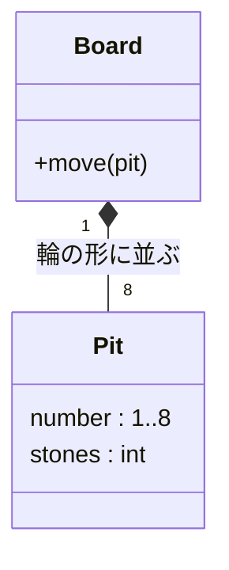

# ドメインモデル

用語（ユビキタス言語）は README.md の「用語」に従う。

STEP 01 時点のモデル。

- 盤面（Board）は8つの穴（Pit）を持つ。穴は輪の形に並び、8の隣は1。
- 穴は石（stone）の数を持つ。石は区別しないので、数だけを扱う。
- 手（move）は、穴を1つ選んで、その穴の石を時計回りに蒔く操作。
  - 物理的には「石を握った手」があるが、モデルには入れない。蒔いている途中の残りの石は、計算途中の一時的な値として扱う。
